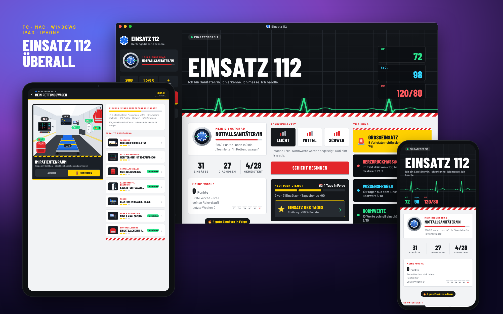
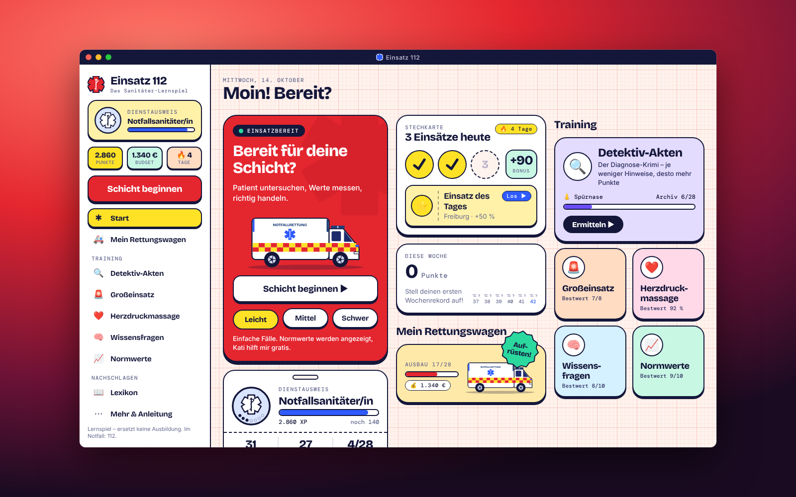
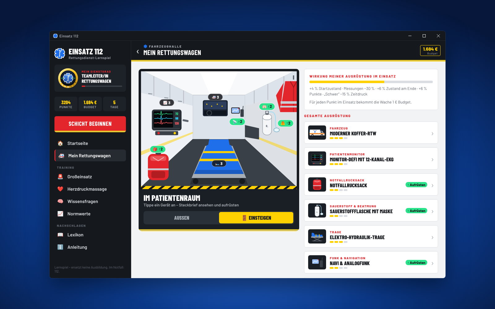
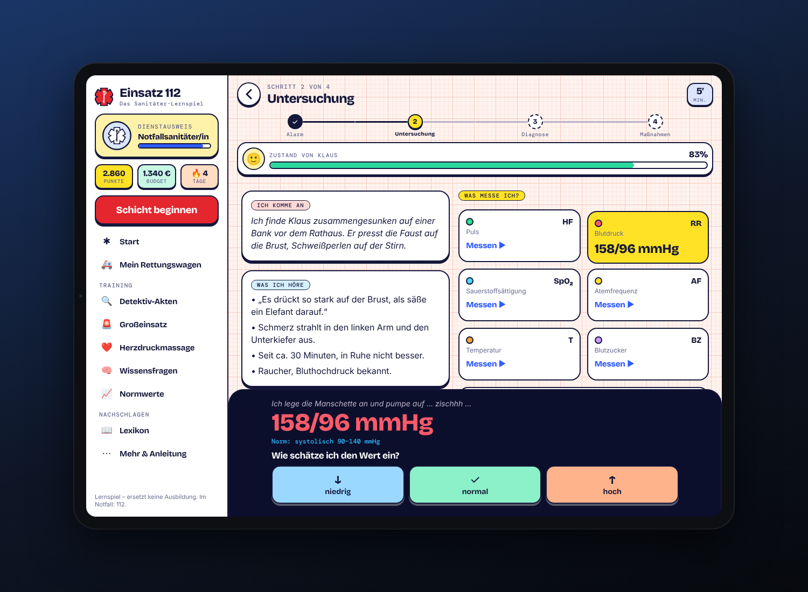
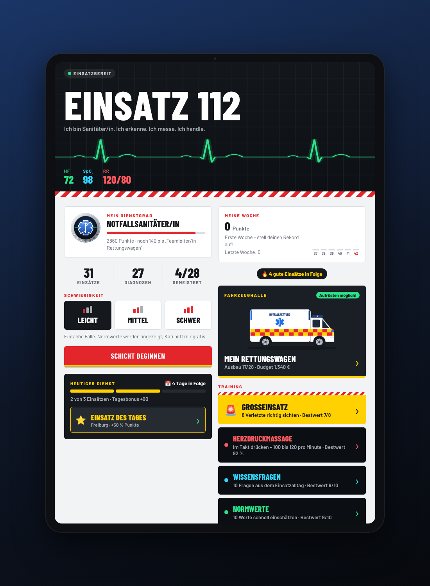

# Einsatz 112 – das Sanitäter-Lernspiel 🚑

> **Ein Freizeitprojekt aus dem Rettungsdienst:** Lerninhalte aus der Sanitätsausbildung – zum Üben als Spiel.



**[▶ Jetzt im Browser spielen](https://rettung.tankard.de)** · kostenlos, ohne Anmeldung, auf iPhone, iPad, Android, PC und Mac

## Über dieses Projekt

Einsatz 112 ist ein **Freizeitprojekt eines Rettungssanitäters**.

Die Idee dahinter: Was man in der Sanitätsausbildung lernt, soll man nicht nur im Lehrbuch lesen. Man soll es
**spielerisch üben** können – zwischendurch, auf dem Handy, Einsatz für Einsatz. Gemeint sind Normwerte,
das ABCDE-Schema, typische Krankheitsbilder, die richtigen Erstmaßnahmen, Wiederbelebung und die Sichtung beim Großeinsatz.

Statt Karteikarten gibt es Einsätze. Die Leitstelle alarmiert, ich fahre mit meiner Kollegin Kati raus und
untersuche den Patienten. Ich messe Vitalwerte, stelle eine Verdachtsdiagnose und entscheide, was zu tun ist.
Fehler sind ausdrücklich erlaubt: Nach jedem Einsatz erklärt der Einsatzbericht, worauf es ankam und woran man
das Krankheitsbild erkennt.

### Was man übt

| Lerninhalt aus der Ausbildung | So kommt er im Spiel vor |
|---|---|
| **Vitalwerte und Normbereiche** (Erwachsene und Kinder) | Puls, Blutdruck, SpO₂, Atemfrequenz, Temperatur, Blutzucker, GCS und EKG messen und als niedrig, normal oder hoch einstufen; Training „Normwerte“ |
| **Strukturiertes Vorgehen** (ABCDE, SAMPLER, GCS, BE-FAST, 5 W) | Anamnese und Sichtbefund in jedem Einsatz; Nachschlagen im Lexikon |
| **Krankheitsbilder erkennen** | 28 Einsätze von Hypoglykämie über Schlaganfall bis Spannungspneumothorax, davon 4 Kinder-Notfälle |
| **Erstmaßnahmen** | die richtigen Maßnahmen auswählen – falsche kosten EP und schaden dem Patienten |
| **Reagieren, wenn es kritisch wird** | Zwischenfälle mitten im Einsatz, z. B. Kammerflimmern oder Erbrechen |
| **Herz-Lungen-Wiederbelebung** | Herzdruckmassage im Takt von 100–120/min, 30:2 |
| **Sichtung beim Großeinsatz (MANV)** | 8 Verletzte nach einem vereinfachten mSTaRT-Schema einteilen |
| **Theorie** | 48 Wissensfragen aus dem Einsatzalltag mit Erklärung |

### Warum ein Spiel?

Gelerntes bleibt hängen, wenn man es oft wiederholt. Deshalb gibt es kleine Anreize, um dranzubleiben:
einen Einsatz des Tages, eine Dienst-Serie, Abzeichen und eine Beförderung vom Praktikanten bis zur
„Rettungsdienst-Legende“. Dazu kommt ein eigener Rettungswagen, den man mit den gesammelten EP Stufe für
Stufe modern ausrüstet.

### Grundsätze

- **Kostenlos** – keine Werbung, keine In-App-Käufe
- **Keine Datensammlung** – kein Konto, kein Tracking; der Spielstand bleibt auf dem eigenen Gerät
  ([Datenschutzerklärung](docs/DATENSCHUTZ.md))
- **Komplett auf Deutsch**; die Einsätze spielen in ganz Deutschland
- **Läuft überall im Browser:** iPhone, iPad, Android, PC und Mac – auch als App auf dem Home-Bildschirm

> ⚠️ **Wichtig:** Einsatz 112 ist ein Lernspiel mit **vereinfachten** Inhalten. Es ersetzt keine Ausbildung,
> keine Praxisanleitung, keine ärztliche Beratung und keine regionalen Leitlinien oder SOPs. Welche Maßnahmen
> man durchführen darf, hängt von der eigenen Qualifikation und dem Rettungsdienstbereich ab.
> **Im Notfall: 112.**

### Feedback

Fehler gefunden, fachlich etwas anders gelernt oder eine Idee für einen neuen Einsatz?
Dann gerne ein [Issue](https://github.com/tobiaslangde-eng/rettung/issues) anlegen. Hinweise aus Ausbildung und
Praxis sind ausdrücklich willkommen.

---

## So spielt es sich

Beim ersten Start wähle ich meine **Rolle** – jede hat ihren eigenen Spielstand, gewechselt wird jederzeit unter „Mehr“:

- **Ersthelfer/in:** alles, was im Erste-Hilfe-Kurs drankommt – ohne Krankheitsbilder-Detektivarbeit. 56 Notfälle (Herzstillstand im
  Supermarkt, Unfall auf der Autobahn, Verschlucken im Restaurant, Kind im Badesee …) in vier Schritten: *Lage → Prüfen → Erkennen → Handeln*.
  Dazu zehn Trainings: **Wissensfragen** (rund 130 Kursfragen), **Schritt für Schritt** (28 Abläufe), **Herzdruckmassage**, **Notruf üben**
  (12 Leitstellen-Gespräche), **Mythos oder Wahrheit?** (50 Aussagen), **Was zuerst?** (40 Entscheidungen), **Gut gepackt**
  (Verbandkasten, Hausapotheke …), **Handgriffe** (56 Fragen zu Lagern, Verbinden, Kühlen …), **Defi-Training** (8 AED-Szenarien) und die
  **Erste-Hilfe-Prüfung** (20 Fragen, bestanden ab 16). Dazu ein Erste-Hilfe-Lexikon. Mit den EP rüste ich **mein eigenes Auto** aus: jede Ausrüstung hat eine eigene Wirkung (z. B. weniger Abzug bei Fehlern, mehr EP für wichtige Prüfungen, Hinweise durch das Licht), dazu gibt es **Ausrüstungs-Sets** mit Bonus und jeden Tag ein **Tagesangebot** mit 25 % Rabatt.
- **Sanitäter/in:** das Rettungsdienst-Spiel mit Untersuchung, Messwerten, Diagnosen und dem eigenen Rettungswagen (unten).

**Spielweise:** Nach der Rollenwahl entscheide ich, ob ich **mit Geschichte** spiele (Kati, Kapitel, Bereiche schalten sich nach und nach frei) oder **frei** (alles von Anfang an offen, keine Geschichte). Das lässt sich jederzeit unter „Mehr“ umstellen.

**Die Geschichte:** Beide Rollen erzählen eine Geschichte (Sanitäter: elf, Ersthelfer: 20 Kapitel) mit Kati als Begleiterin – vom Erste-Hilfe-Kurs
für den Führerschein bis zur Ersthelfer-App bzw. vom ersten Tag auf der Wache bis zur Praxisanleitung. Jedes Kapitel hat
eine Aufgabe und schaltet neue Bereiche frei, so baut alles aufeinander auf. Am Ende der Ersthelfer-Geschichte wartet der
Weg in den Rettungsdienst.

**Als Sanitäter/in** wird in der **Ich-Perspektive** erzählt: Ich fahre mit meiner Kollegin Kati zu Einsätzen quer durch Deutschland.

1. **Alarm:** Einsatzmeldung der Leitstelle (Köln, Heidelberg, Lübeck, Rügen, Müritz …), danach Blaulichtfahrt.
2. **Untersuchung:** Anamnese und Sichtbefund lesen, Werte messen
   (Puls, Blutdruck, SpO₂, Atemfrequenz, Temperatur, Blutzucker, GCS, 12-Kanal-EKG)
   und jeden Wert als *niedrig / normal / hoch* einstufen. Jede Messung kostet eine Minute.
3. **Diagnose:** Verdachtsdiagnose aus vier Möglichkeiten wählen.
4. **Maßnahmen:** Alle richtigen Erstmaßnahmen auswählen – falsche kosten EP.
5. **Einsatzbericht:** EP, Sterne, Erklärung und Leitsymptome. Ich erfahre auch, wie der Patient in der Klinik ankommt.

### Schwierigkeitsstufen

| Stufe | Fälle | Hilfen | Druck | EP |
|---|---|---|---|---|
| ◆◇◇ **Leicht** | einfache Fälle | Normwerte sichtbar, Kati gibt Tipps und 50:50 gratis | gering | ×1 |
| ◆◆◇ **Mittel** | mittlere Fälle | Normwerte muss ich kennen, Katis Tipps kosten 10 EP | mittel | ×1,5 |
| ◆◆◆ **Schwer** | komplexe Fälle | keine Hilfe, Feedback erst im Bericht | Patient verschlechtert sich in Echtzeit | ×2 |

### Spielelemente

- **Tagesdienst:** jeden Tag ein „Einsatz des Tages“ (+50 % EP) und ein Tagesziel von 3 Einsätzen;
  wer es mehrere Tage hintereinander schafft, baut eine Dienst-Serie mit steigendem Bonus auf
- **Zwischenfälle:** In 17 Einsätzen passiert mitten in der Untersuchung etwas Unerwartetes
  (z. B. Kammerflimmern, Erbrechen, Status epilepticus) – ich muss sofort richtig reagieren
- **Kinder-Einsätze:** 4 Fälle mit kleinen Patienten (Fieberkrampf, Pseudokrupp, verschluckte Erdnuss,
  Exsikkose); bewertet wird mit Kinder-Normwerten für Puls, Atmung und Blutdruck
- **Detektiv-Akten – der Diagnose-Krimi:** Jede Akte ist ein Notfall, von dem anfangs nur die Meldung der Leitstelle
  bekannt ist. Ich decke Hinweise auf (Person, Fundort, Aussagen, Befund, Messwerte) und stelle meinen Verdacht.
  Je weniger Hinweise ich brauche, desto mehr EP: Combo bis ×2, „Geniestreich“ mit goldenem Stempel, ein Archiv
  mit 196 Akten zum Sammeln und eigene Detektiv-Ränge bis „Meisterdetektiv/in“. Die Akten decken 82 Krankheits- und
  Verletzungsbilder in acht Kategorien ab (Herz & Kreislauf, Atmung, Nerven & Psyche, Stoffwechsel & Bauch,
  Verletzungen, Umwelt & Vergiftung, Kinder, Schwangerschaft & Geburt) – jedes Bild in mehreren Situationen:
  anderer Ort, anderes Alter, typischer, untypischer oder irreführender Verlauf. Pro Ermittlung kommt jedes Bild nur
  einmal vor und die Kategorien sind gemischt. Nach jeder Akte gibt es die Auflösung mit den Leitsymptomen – und alle
  EP landen als Coins beim Rettungswagen
- **Großeinsatz (MANV):** 8 Verletzte nach einem vereinfachten mSTaRT-Schema sichten (Rot, Gelb, Grün, Schwarz)
- **Mein Rettungswagen (Fahrzeughalle):** Jeder EP bringt 1 Coin. Damit rüste ich Fahrzeug,
  Patientenmonitor, Notfallrucksack, Beatmung, Trage, Funk und Einsatzkleidung in vier Stufen auf
  (vom Krankenwagen Baujahr 1999 bis zum Elektro-RTW 2026). Jede Stufe hilft im Einsatz; höhere Stufen
  werden mit dem Dienstgrad freigeschaltet. Ich kann den Wagen von außen ansehen oder einsteigen. Dann stehe ich
  in der Ich-Perspektive im Patientenraum, tippe Geräte an und sehe ihren Steckbrief mit Großansicht, Infos und
  Vorschau auf die nächste Stufe.
- **Meine Woche:** Wochenpunkte mit Verlauf der letzten 6 Wochen und Wochenrekord
- **Training Herzdruckmassage:** im Takt von 100–120/min auf den Brustkorb tippen, 2 Runden 30:2,
  mit Live-Anzeige, Taktgeber (abschaltbar für doppelte EP) und Auswertung der Beatmungspause
- **Training Wissensfragen:** 48 Fragen aus dem Einsatzalltag, je 10 pro Runde, mit Erklärung
- **Training Normwerte:** 10 zufällige Messwerte in Folge als niedrig, normal oder hoch einstufen
- **Zustandsbalken** des Patienten: Jede Messung kostet Kraft, Fehler schaden, richtige Maßnahmen helfen
- **Kati**, meine Kollegin, gibt Tipps und kann zwei falsche Diagnosen ausschließen (50:50)
- **21 Abzeichen** (z. B. „Lehrbuchreif“, „Taktgefühl“, „Dienstwoche“) mit je 50 Bonuspunkten
- **Bonuspunkte** für perfekte Einsätze und Serien 🔥, **8 Dienstgrade** von *Praktikant/in* bis zur
  *Rettungsdienst-Legende* – jede Beförderung wird im Einsatzbericht gefeiert
- **Lexikon:** Normwerte, alle Krankheitsbilder und Rettungswissen – Notruf (5 W), Rettungskette, ABCDE,
  Wiederbelebung, Seitenlage, BE-FAST, SAMPLER, GCS, Schockzeichen, Sichtung, Kindernotfälle

Der Spielstand wird nur lokal gespeichert. Über *Mehr → Spielstand übertragen* lässt er sich als Code
auf ein anderes Gerät mitnehmen.

### Enthaltene Fälle (28)

- **Leicht (11):** Herzinfarkt, Hypoglykämie, Schlaganfall, Asthmaanfall, Kreislaufkollaps, Unterarmbruch, Verbrennung, Nierenkolik, Alkoholvergiftung, Fieberkrampf (Kind), Pseudokrupp (Kind)
- **Mittel (11):** Anaphylaxie, Hypothermie, Hitzschlag, Hyperventilation, Krampfanfall, hypertensiver Notfall, Opioid-Überdosis, Gehirnerschütterung, COPD, verschluckte Erdnuss (Kind), Exsikkose (Kind)
- **Schwer (6):** Sepsis, Lungenembolie, Lungenödem, Kohlenmonoxidvergiftung, diabetische Ketoazidose, Spannungspneumothorax (plus die mittleren Fälle)

## Auf jedem Gerät

Die Oberfläche passt sich an die Bildschirmgröße an:

- **iPhone/Handy:** eine Spalte mit schwebender Tab-Leiste, alles mit dem Daumen erreichbar
- **iPad hoch:** zwei Spalten; **iPad quer, PC und Mac:** feste Seitenleiste mit Dienstgrad, Coins und Menü,
  Startseite in drei Spalten, Untersuchung mit Patient links und Messwerten rechts, Lexikon als Kachel-Raster
- **Desktop-App:** Fenster 1280 × 820, unter macOS mit Ampel-Knöpfen in der dunklen Titelleiste, unter Windows mit
  dunkler Titelleiste und den Windows-Fensterknöpfen; kleiner gezogen wird sie zur Handy-Ansicht

| Mac | Windows |
|---|---|
|  |  |
| **iPad quer** | **iPad hoch** |
|  |  |

## Gefahren-Check, Stadtkarte und Urkunden

- **Gefahren-Check** (Training, beide Rollen): Eine Einsatzstelle als Bild mit antippbaren Gegenständen. Alle echten Gefahren finden (Eigenschutz), harmlose Dinge nicht antippen. Nach jedem Tipp gibt es eine Erklärung; am Ende einen Merksatz. 10 Szenen für Ersthelfer/innen, 10 für den Rettungsdienst.
- **Stadtkarte** (Startseite): Auf einer Karte erscheinen drei Einsätze mit Anfahrtszeit. Wer den Einsatz mit der kürzesten Anfahrt wählt, bekommt +10 EP. Das Fahrzeug fährt über die Straßen, danach startet der Einsatz; nach dem Einsatz geht es zurück zur Karte.
- **Urkunden** (Startseite): Für Ränge und große Ziele gibt es Urkunden mit eigenem Namen (Ersthelfer: Kurs, Prüfung, Hilfspunkt, Herzdruck, Gefahren-Check, Karte; Sanitäter: Ausbildung, Detektiv, Großeinsatz, Wache u. a.). Als Bild speichern oder teilen. Auf jeder Urkunde steht, dass sie eine Spiel-Urkunde ist und keine Ausbildung ersetzt.

## EP, Level und Coins

- **EP (Erfahrungspunkte)** gibt es für alles, was man richtig macht. Sie bestimmen das **Level** (jedes Level dauert etwas länger als das vorherige) und den **Dienstgrad** („Rang“).
- **Coins** sind die Spielwährung (kein echtes Geld): Für jeden EP gibt es 1 Coin. Damit kauft man Ausrüstung und baut Wache oder Hilfspunkt aus. Einkaufen kostet nur Coins, keine EP.

## Training, Einführung und „Frag Kati“

- **Training** hat drei Bereiche: **Lernpfad** (die Kapitel der Geschichte als Weg von oben nach unten, wie bei Duolingo), **Üben** (alle Trainings in Gruppen) und **Spielmodi** (Einsatz, Einsatz des Tages, Schicht, Stadtkarte, Duell).
- **Startseite:** oben Level, EP, Coins, Serie und Auto-Stand; darunter „Heute dran“ mit dem Knopf „Jetzt spielen“.
- **Einführung** für neue Spieler (Ziel, Menü, Lernpfad, EP/Level/Coins, Serie); jederzeit unter „Mehr“ wieder aufrufbar.
- **Suche im Lexikon** und **Frag Kati**: Antworten kommen aus den Inhalten der App (Lexikon, Spickzettel, Abläufe, Fragen), mit Synonymen und Tippfehler-Toleranz. Das ist keine echte KI: Es wird nichts erfunden und nichts an einen Server geschickt (`src/game/wissen.ts`). Eine echte KI bräuchte einen eigenen Server (Schlüssel, Kosten, Sicherheitsprüfung).
- **Figuren** mit Gesichtern, Händen und Schuhen; Patienten-Porträts passen zu Alter und Geschlecht (`src/components/Gesicht.tsx`).

## Weitere Spielmodi und Werkzeuge

- **Tagesserie** mit Belohnung, **Schichtmodus** (vier Einsätze am Stück mit Dienstbilanz), **Duell mit Freunden** (gleiche fünf Fragen per Link, ohne Server).
- **Leitstelle spielen**, **Fehler finden**, **Handgriff-Labor** mit 8 Übungen (Druckverband, Seitenlage, Bewusstsein und Atmung prüfen, Verbrennung, Armschlinge, Verschlucken, Tourniquet, Rettungsdecke).
- **Stadtkarte** mit Orten, Staus und Baustellen: zwei Routen zur Wahl, Bonus fürs Umfahren.
- **Spickzettel** je Rolle, **Ergebnis als Bild teilen**, **Sprachausgabe** beim Notruf (Browser-Stimme, abschaltbar).
- **Darstellung** (Mehr): Farbmodus Auto/Hell/Dunkel (Auto folgt dem Gerät) und größere Schrift (nur Web) sowie **Rückmeldung geben**.
- Nicht enthalten: eine englische Version (Texte und medizinische Inhalte sind durchgehend deutsch).

## Design „Puls“

Hell oder dunkel (echtes Farbsystem in `src/theme.ts`, Wechsel unter „Mehr“), frisch und klinisch-sauber: ein **Bento-Raster** aus bunten Pastell-Kacheln auf Mintweiß, tiefes Petrolgrün als Tinte, **Teal** für Ersthelfer/innen und **Signalrot** für Sanitäter/innen. Medizinischer Touch durch EKG-Papier mit Herzschlag-Linie, Zahlen wie auf dem Patientenmonitor und Kreuz-Motive. Überschriften in *Bricolage Grotesque*, Lesetext in *Inter*. Details: [`docs/DESIGN.md`](docs/DESIGN.md). Die Startseite ist ein „Heute“-Hub: Hauptaktion zuerst, Schnellzugriff-Leiste (Karte, Schicht, Duell, Spickzettel, Urkunden), empfohlene Trainings; das Training ist in Gruppen geordnet. Frühere Varianten zum Vergleich: `/vorschau/leitstelle/` und `/vorschau/klar/`.

**Mein Hilfspunkt (Ersthelfer/in):** Das Gegenstück zur Wache – ein Vereinsheim als Erste-Hilfe-Stützpunkt mit Hausapotheke, Erste-Hilfe-Raum, Defi-Station, Helfer-Netzwerk und Kursraum (je drei Stufen). Jeder Bereich wirkt in Notfällen und Trainings. Auch die Auto-Ausrüstung hat für jede Stufe eine eigene Grafik.

**Meine Rettungswache (Sanitäter/in):** Mit dem Coins aus Einsätzen und Trainings baue ich fünf Bereiche aus – Fahrzeughalle,
Funkraum, Materiallager, Ruheraum und Schulungsraum, je drei Stufen. Das Bild der Wache wächst mit, und jeder Bereich wirkt im Einsatz
(z. B. besserer Startzustand, langsamer sinkender Zustand, mehr EP).

## Spielen und herunterladen

Einsatz 112 gibt es **vorerst nur als Web-App**: <https://rettung.tankard.de>
Sie läuft mit eigenem Icon, im Vollbild und offline. Bei jeder Änderung wird sie automatisch neu
veröffentlicht (`.github/workflows/web-app.yml`).

- **iPhone & iPad:** Link in **Safari** öffnen → Teilen-Symbol → **„Zum Home-Bildschirm“**
- **Android:** Link in Chrome öffnen → Menü ⋮ → **„App installieren“** bzw. „Zum Startbildschirm hinzufügen“
- **PC & Mac:** Link in Chrome oder Edge öffnen → Installieren-Symbol in der Adressleiste (oder einfach im Browser spielen)

### Native Apps (stillgelegt)

Die nativen Apps sind fertig vorbereitet, werden aber **nicht mehr automatisch gebaut**. Bei Bedarf lassen sie sich
jederzeit per Hand bauen: *Actions → „App bauen“ → Run workflow*. Wieder dauerhaft einschalten: in
`.github/workflows/android-apk.yml` die auskommentierten `push`-Zeilen aktivieren. Ältere Builds liegen weiter unter
[**Releases**](https://github.com/tobiaslangde-eng/rettung/releases). Der Workflow erzeugt:

- **Einsatz112-Windows.exe** – Desktop-App für Windows (Doppelklick, keine Installation)
- **Einsatz112-Mac-arm64.dmg / Einsatz112-Mac-x64.dmg** – Desktop-App für Mac (Apple-Chip / Intel)
- **Einsatz112-Linux.AppImage** – Desktop-App für Linux
- **Einsatz112.apk** – die Android-App (auf dem Handy öffnen und „Installation aus unbekannten Quellen“ erlauben)
- **Einsatz112-iOS-unsigniert.ipa** – iOS-App zum Sideloaden mit [Sideloadly](https://sideloadly.io) oder [AltStore](https://altstore.io) und der eigenen Apple-ID (kostenlose Apple-ID: läuft 7 Tage, dann neu installieren)
- **Einsatz112-Web.html** – das ganze Spiel als eine Datei für jeden Browser, auch offline

Die Desktop-Apps (Ordner `desktop/`, Electron) laden die Web-Version in ein eigenes Fenster und laufen
offline. Sie sind nicht von Microsoft/Apple zertifiziert: Windows zeigt beim ersten Start „Weitere
Informationen → Trotzdem ausführen“, auf dem Mac beim ersten Start Rechtsklick → *Öffnen*.

**App Store, Google Play und Microsoft Store** (für später, ebenfalls nur per Hand): Schritt-für-Schritt-Anleitung in [`docs/STORES.md`](docs/STORES.md) – kein eigener Computer nötig. Gebaut wird über den Workflow „Store-Veröffentlichung“ (Expo EAS); Texte und Bilder: [`docs/APPSTORE-EINTRAG.md`](docs/APPSTORE-EINTRAG.md), [`docs/PLAYSTORE-EINTRAG.md`](docs/PLAYSTORE-EINTRAG.md).

---

## Für Entwickler

Gebaut mit **Expo / React Native** und TypeScript.

```bash
npm install
npx expo start        # QR-Code mit Expo Go scannen
npx expo start --web  # im Browser
npm run typecheck     # Typecheck
npm run build:web     # dist/kiirabi.html – das ganze Spiel als eine eigenständige Datei
```

Desktop-App lokal bauen: `cd desktop && npm install && npm run prepare-app && npm run dist:linux` (bzw. `dist:win`, `dist:mac`).
Die Web-App veröffentlicht der Workflow „Web-App veröffentlichen“ auf GitHub Pages (Branch `gh-pages`).

### Projektstruktur

```
App.tsx                 Navigation (Zustandsautomat) & Fortschritt
src/theme.ts            Farben & Typografie (Rettungsdienst-Design)
src/layout.tsx          Anpassung an Handy, Tablet und Desktop
src/components/Ems.tsx  Star of Life, Warnmarkierung, Reflexstreifen, Monitor, EKG, Stadt, Rangabzeichen
src/components/         Buttons, Karten, Kati, Blaulichtfahrt, Rettungswagen, Geräte, Seitenleiste
src/data/vitals.ts      Vitalwerte, Normbereiche (auch für Kinder), Einstufung
src/data/cases.ts       Einsatzfälle
src/data/questions.ts   Wissensfragen
src/data/incidents.ts   Zwischenfälle in Einsätzen
src/data/manv.ts        Großeinsatz: Verletzte und Sichtungsschema
src/data/basics.ts      Rettungswissen fürs Lexikon
src/game/scoring.ts     EP, Sterne, Ränge, Patientenzustand
src/game/difficulty.ts  Schwierigkeitsstufen
src/game/daily.ts       Tagesdienst: Einsatz des Tages, Tagesziel, Dienst-Serie
src/game/cpr.ts         Herzdruckmassage-Training: Takt messen und bewerten
src/game/quiz.ts        Normwerte- und Wissensfragen-Training
src/game/achievements.ts Abzeichen
src/game/manv.ts        Großeinsatz-Runden und EP
src/game/weekly.ts      Wochenpunkte und Wochenrekord
src/game/equipment.ts   Fahrzeughalle: Ausrüstungsstufen, Kosten und Wirkung
src/game/detective.ts   Detektiv-Akten: Auswahl, Hinweise, EP, Combo, Archiv, Ränge
src/data/akten/         Detektiv-Akten: Krankheitsbilder und Situationen (je Kategorie eine Datei)
src/game/storage.ts     Speicherung (AsyncStorage) und Spielstand-Übertragung
src/screens/            Start, Einsatz, Ergebnis, Training, Fahrzeughalle, Lexikon, Mehr (Anleitung)
```

Neue Fälle lassen sich einfach in `src/data/cases.ts` ergänzen.
